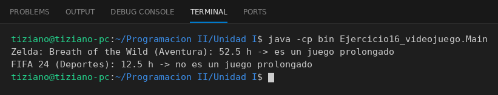

# Videojuego

Programación II - Unidad 1 - Ejercicio 16

## Consigna
Representar un videojuego de la biblioteca de un usuario y registrar sus horas de juego acumuladas.

## Lógica
- **Atributos (privados):** `nombre`, `genero` (String) y `horasJugadas` (double).
- **Constructor:** valida que las horas iniciales no sean negativas.
- **`registrarSesion(horas)`:** suma las horas al acumulado; rechaza sesiones no positivas.
- **`esJuegoProlongado()`:** retorna `true` si `horasJugadas > 50`.
- **`Main`:** dos juegos (Zelda con 48 h y FIFA con 10.5 h), suma una sesión a cada uno e imprime si califican como prolongados (Zelda pasa a 52.5 h y sí; FIFA no).

## Ejecución

